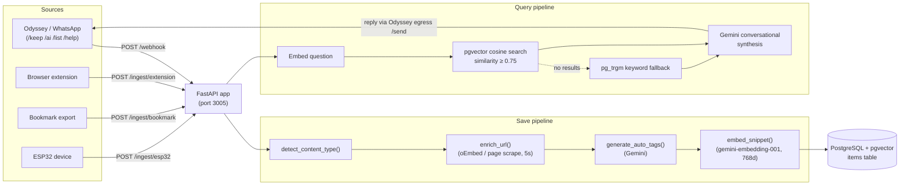
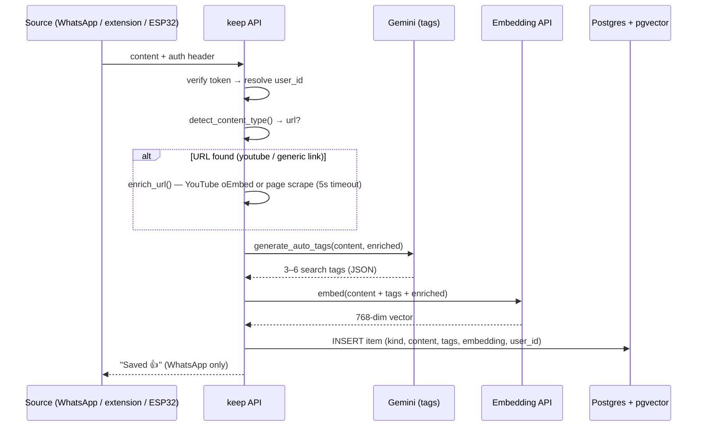
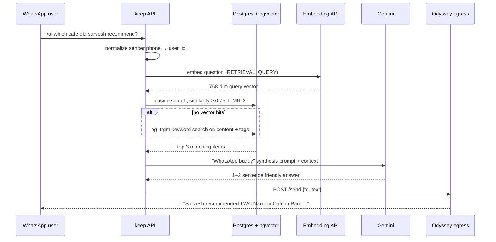

# keep

Notes / Links / Voice transcription service. Receives data from **[Odyssey (WhatsApp bot)](https://github.com/joshi-kaushal/odyssey)**, a browser extension, bookmark exports, and an ESP32 device — then enriches, auto-tags, and embeds each item so you can ask questions over your own notes with semantic RAG.

**Multi-tenant**: every item belongs to a `user_id` (WhatsApp senders are identified by their
phone number; direct ingestions use an `x-user-id` header). Retrieval is always scoped to the caller's own data.

> The current version only supports WhatsApp bot. Connections with other services is not fully tested yet.

## Stack

- Python 3.12 + FastAPI
- PostgreSQL 16 + **pgvector** (via SQLAlchemy 2.0 + psycopg2)
- **Gemini** for auto-tagging & conversational answers, embeddings via the Gemini Embedding API
- pgAdmin 4 for DB inspection

## Architecture



### Saving an item (`/keep`, extension, bookmark, ESP32)



### Asking a question (`/ai <question>`)



## Run

```bash
cp .env.example .env        # then fill in real tokens & GEMINI_API_KEY
docker compose up --build
```

- API: http://localhost:3005
- pgAdmin: http://localhost:5050
- Postgres: localhost:5432 (user: `keep`, pass: `keep`, db: `keep`)
- Requires the external docker network once: `docker network create keep`

## Endpoints

| Method | Path                | Auth Header         | Purpose                                          |
| ------ | ------------------- | ------------------- | ------------------------------------------------ |
| GET    | `/health`           | none                | health check                                     |
| POST   | `/webhook`          | `x-gateway-secret`  | Odyssey: `/keep`, `/ai`, `/list`, `/help`, voice |
| POST   | `/ingest/extension` | `x-extension-token` | browser extension                                |
| POST   | `/ingest/bookmark`  | `x-extension-token` | bookmark export                                  |
| POST   | `/ingest/esp32`     | `x-esp32-token`     | ESP32 device                                     |

All `/ingest/*` endpoints accept an optional `x-user-id` header (defaults to
`DEFAULT_USER_ID`). The `/webhook` derives `user_id` from the sender's phone number.

### WhatsApp commands (via Odyssey)

| Command               | Action                                        |
| --------------------- | --------------------------------------------- |
| `/keep <text or url>` | save a note/link (enriched, tagged, embedded) |
| `/ai <question>`      | ask over your saved notes (semantic RAG)      |
| `/list [n]`           | show last n items (default 10, max 50)        |
| `/help`               | show command help                             |

## Data model (`items` table)

| Column                                | Notes                                                                    |
| ------------------------------------- | ------------------------------------------------------------------------ |
| `id`                                  | UUID string PK                                                           |
| `user_id`                             | tenant owner (indexed)                                                   |
| `kind`                                | `note` \| `link` \| `transcript`                                         |
| `context`                             | `text` \| `audio` \| `link`                                              |
| `content` / `original`                | useful text / raw Marathi transcript (voice)                             |
| `source`                              | `whatsapp` \| `extension` \| `esp32` \| `bookmark`                       |
| `meta`                                | JSONB                                                                    |
| `url`, `content_type`                 | extracted URL; `note` \| `youtube` \| `instagram` \| `twitter` \| `link` |
| `auto_tags`                           | text[] of Gemini search tags                                             |
| `enriched_text` / `enrichment_status` | fetched page context; `done` \| `skipped` \| `failed`                    |
| `embedding`                           | `vector(768)`                                                            |
| `created_at` / `updated_at`           | server defaults                                                          |

Indexes: HNSW cosine on `embedding`, GIN trigram on `content`, plus btree on
`user_id`, `created_at`, `kind`, `source`. The lifespan hook enables the `vector`
and `pg_trgm` extensions on startup.

## Layout

```
keep/
├── app/
│   ├── main.py           # FastAPI entrypoint + lifespan (extensions, create_all)
│   ├── config.py         # settings (env-driven)
│   ├── schemas.py        # Pydantic models
│   ├── db/
│   │   ├── models.py     # Item ORM + HNSW/GIN indexes
│   │   └── session.py    # engine + session + get_db
│   ├── routers/
│   │   ├── webhook.py    # /webhook — Odyssey intents (/keep /ai /list /help)
│   │   └── ingest.py     # /ingest/* — extension/bookmark/esp32
│   └── services/
│       ├── enrichment.py # content-type detection + URL enrichment (oEmbed/scrape)
│       └── rag.py        # auto-tags, embeddings, vector + trigram retrieval, QA synthesis
├── Dockerfile
├── docker-compose.yml    # db (pgvector), pgadmin, api
├── requirements.txt
├── .env.example
└── README.md
```

## Environment variables

See `.env.example`. `DATABASE_URL` must match the docker-compose postgres service.

| Var                               | Purpose                                              |
| --------------------------------- | ---------------------------------------------------- |
| `DATABASE_URL`                    | SQLAlchemy Postgres DSN                              |
| `ODYSSEY_URL` / `ODYSSEY_API_KEY` | egress replies back to WhatsApp                      |
| `NOTES_WEBHOOK_SECRET`            | `/webhook` auth (`x-gateway-secret`)                 |
| `EXTENSION_TOKEN` / `ESP32_TOKEN` | direct ingestion auth                                |
| `GEMINI_API_KEY`                  | tagging, embeddings & QA (required for RAG features) |
| `DEFAULT_USER_ID`                 | fallback tenant when no user is derivable            |
| `PORT`                            | API port (default 3005)                              |

## See also

- `../llm/new-service-plan.md` — full design spec
- `task.md` — milestone plan for the multi-tenant semantic RAG build
